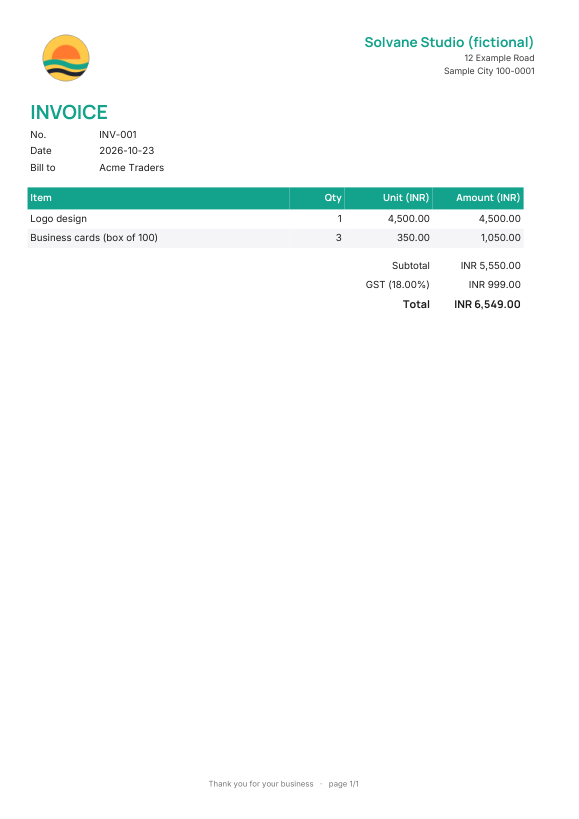

# invoice-generator

Branded **invoice and receipt PDFs** from CSV, JSON or a shared Google Sheet, using one command and one config file. The business name, address, logo, colours, currency, tax label and rate, and footer all live in `brand.json`, so they can be changed without touching code.



```sh
pip install fpdf2
python invoicegen.py --config samples/brand.json --csv  samples/invoices.csv  --out out
python invoicegen.py --config samples/brand.json --json samples/invoices.json --out out
python invoicegen.py --config samples/brand.json --sheet "https://docs.google.com/spreadsheets/d/<id>/edit#gid=0" --out out
```

Output: `invoice-<no>.pdf`, `receipt-<no>.pdf` and `summary.csv` (subtotal, tax and total per invoice, for checking).

## Behaviour

- **Input:** one row per line item with `invoice_no, date, customer, item, qty, unit_price`. Rows are grouped by invoice number, keeping their order.
- **Money:** Python `Decimal` throughout. The unit price is rounded half-up to 2 decimals, each line amount is rounded, tax is rounded once on the subtotal, and total = subtotal + tax. Thousands separators such as `"4,500.00"` are accepted.
- **Long invoices** paginate automatically (header and footer on every page, "page n/N"). The included 70-line test gives 3 pages, and its totals match an independent recomputation (56,894.25 + 10,240.97 = 67,135.22).
- **Fonts** are Inter and Manrope (SIL OFL; licences in `assets/`). Unicode names such as "Café ünïcode" render.
- **Google Sheets:** the sheet must be shared "anyone with the link can view". It is read through its CSV export URL, with no account or credentials.

## Tested / not tested

Tested here:
- CSV and JSON give identical totals;
- the 70-line pagination and totals;
- rendered output checked visually.

Not tested:
- a live Google Sheet; the export-URL code path has not been run against a real sheet;
- private sheets that need OAuth or a service account;
- multiple tax rates per invoice, discounts, credit notes;
- right-to-left scripts.

The receipt is a template made from the same data. It does **not** by itself prove that payment was received.
