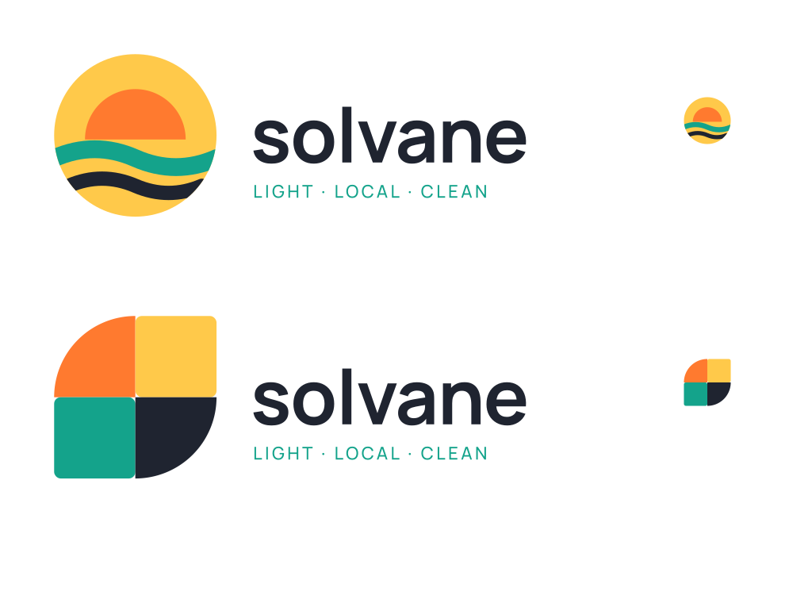

# logo-package-sample

A complete small logo package for a **fictional** brand ("Solvane"). It shows the deliverable format of a minimalist geometric logo job.

## What's in the package

| File | Purpose |
|---|---|
| `svg/<concept>-live.svg` | Fully editable SVG: geometric shapes plus **live text** (font-family Manrope). Opens in any vector editor; the text stays editable when the font is installed. |
| `svg/<concept>-outlined.svg` | The same artwork with the text converted to vector paths, so it renders identically with no fonts installed. |
| `svg/<concept>-icon.svg` | Mark only, square, for favicons and app icons. |
| `png/` | Transparent PNG lockups at 64 / 256 / 512 / 1024 / 2048 px, plus icons at 32 / 64 / 512 px. |
| `jpg/` | 1024 px JPG on white. |
| `style-guide.pdf` / `.svg` | Exact colours (HEX + RGB), typefaces, clear space, minimum sizes, file list. |

There are two concepts: **A-sun** (sun over two waves, circles/arcs clipped to a disc) and **B-tiles** (four quarter-circle/square tiles forming an S).

## How it's built

- `build.py` writes every SVG by hand from geometry (circles, arcs, quadratic curves, rects); there are no embedded raster images (`<image>` count = 0).
- Text is shaped with HarfBuzz (kerning included) and outlined with fontTools.
- PNG, JPG and PDF exports are rendered with CairoSVG.

Fonts: Manrope and Inter, both under the SIL Open Font License (licences in `fonts/`), so the client can use and embed them freely.

## Not covered / not tested

- Native Adobe Illustrator (.ai) or CorelDRAW files. SVG opens in Illustrator, but round-tripping was not tested.
- Print production (CMYK conversion, bleed, Pantone matching).
- Trademark searches.
