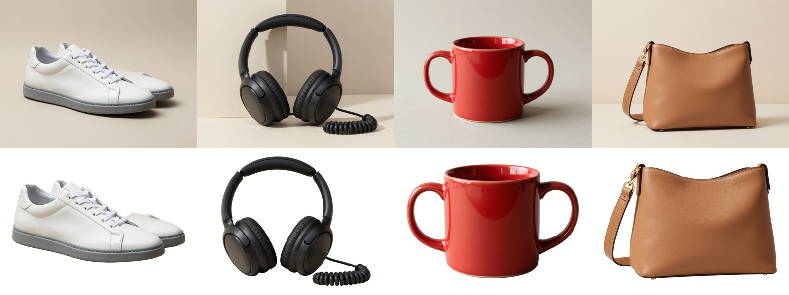

# product-background-removal

Batch **product background removal at the original resolution**. Filenames and aspect ratios are kept, original colours are untouched, and every image gets a 100% edge-check sheet.



```sh
python bgremove.py photos/ out/ --margin 0.06        # local BiRefNet on the GPU; nothing is uploaded
```

| output | what it is |
|---|---|
| `png/<name>.png` | transparent cutout at the **original pixel size**; RGB copied unchanged, only an alpha channel added |
| `white/<name>.jpg` | product on pure white, **original canvas size and aspect ratio**, product centred, never upscaled |
| `framed/<name>.jpg` | same aspect ratio, cropped so every product sits inside the **same margin**; product pixels not resampled |
| `qa/<name>-edges.jpg` | four **1:1 (100%) crops** of the product edge, each on white and on dark grey, for inspection |
| `report.csv` | size, mask coverage, soft-edge share and seconds per image |

## Measured on this sample

Four 2048×1536 photos with typical hard cases:
- a white sneaker on a light backdrop;
- headphones with a coiled cable;
- a two-handled mug, with holes to clear;
- a bag with a thin strap.

Results:
- **about 5 s per image** end to end (model load 1 s) on one RTX 5060 Ti, including writing all outputs and the QA sheets;
- the mug-handle holes and strap loop are cleared;
- the white shoe stays separated from the light backdrop (see `qa/`).

## Limits, stated up front

- **Fine gaps**, such as between the loops of a coiled cable, can keep small background specks. They are visible in `qa/IMG_002-edges.jpg` and are flagged for touch-up, not hidden.
- On a **dark** background a faint backdrop-colour fringe can show on some edges. The white outputs are unaffected.
- **Glass, transparent or very reflective products, hair and fur** are not offered without a sample test first.
- The original shadow is removed. Adding a new drop shadow is a separate option.
- PSD with a layer mask is not produced here.

## About this sample

The four product photos are **AI-generated on our own GPU** (Z-Image via ComfyUI) to stand in for client photos; the products are fictional. This is a self-initiated sample, not paid work.
