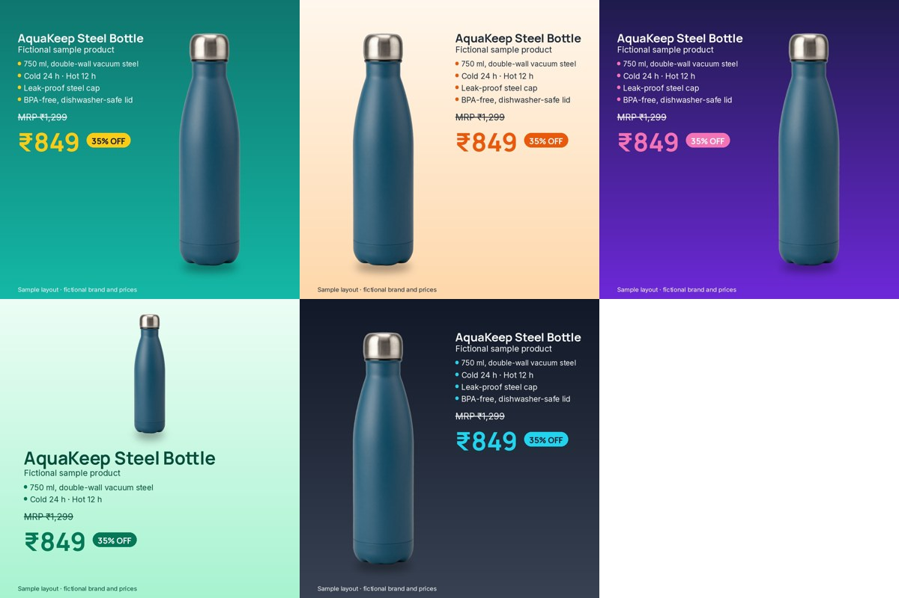

# product-price-cards

Colourful social and e-commerce **product cards with name, specs, MRP and offer price** in five colour and layout variants from one product photo and one facts file.



```sh
python cutout.py product-photo.png product-cutout.png          # local BiRefNet background removal (GPU)
python cards.py facts.json product-cutout.png out/ --size 1080x1080
```

## Why it is built this way

- **The product is never redrawn.** The client's own photo is cut out and placed on the card, so shape, colour, cap and proportions stay those of the real item. Nothing is re-angled, re-invented or upscaled past the source pixels.
- **All text is typeset, not AI-generated.** Every word and number comes from `facts.json`:
  - product name, tagline and spec lines;
  - MRP and offer price;
  - the discount percentage, which is computed (₹1,299 → ₹849 = 35% OFF) rather than typed.
  This means no misspelt specs or invented prices. Text that is too long shrinks to fit and is never cut off.
- `check.txt` lists the exact text placed on each card, so the facts can be proofread against the client's copy before delivery.
- JPEG output, any size up to 2,000 px on the longest edge. Fonts: Inter and Manrope (SIL OFL).

## About this sample

The bottle photo is **AI-generated on our own GPU** (Z-Image, via ComfyUI) to stand in for a client photo. The brand, specs and prices are **fictional**. This is a self-initiated sample, not paid work. In a real job the client supplies the product photo and approves every fact and price before the cards are made.

Not shown here: multiple products per card, client brand fonts or logos (supported by swapping the font and adding an image layer, not yet in this sample), and Hindi or other non-Latin text.
